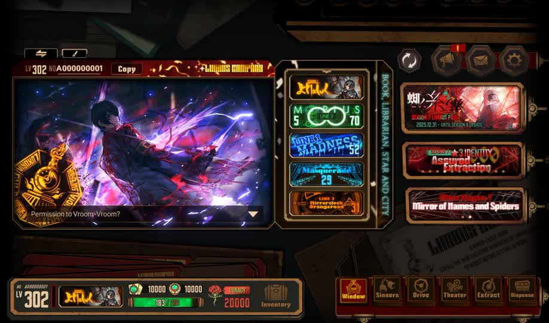
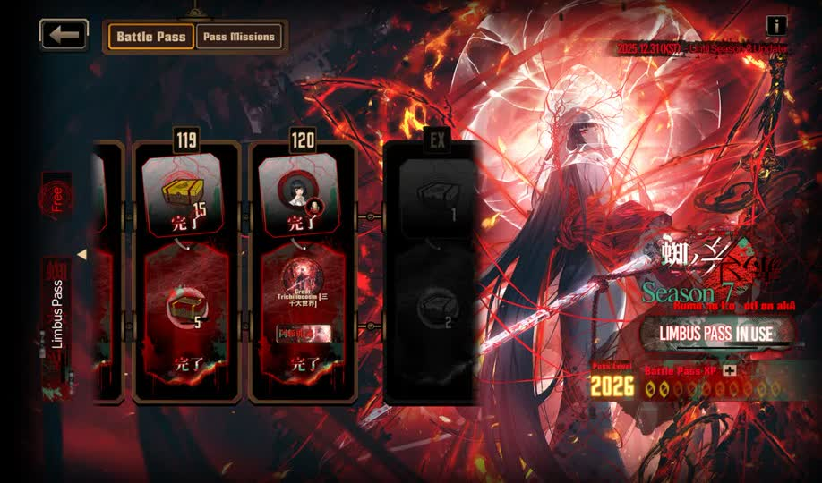
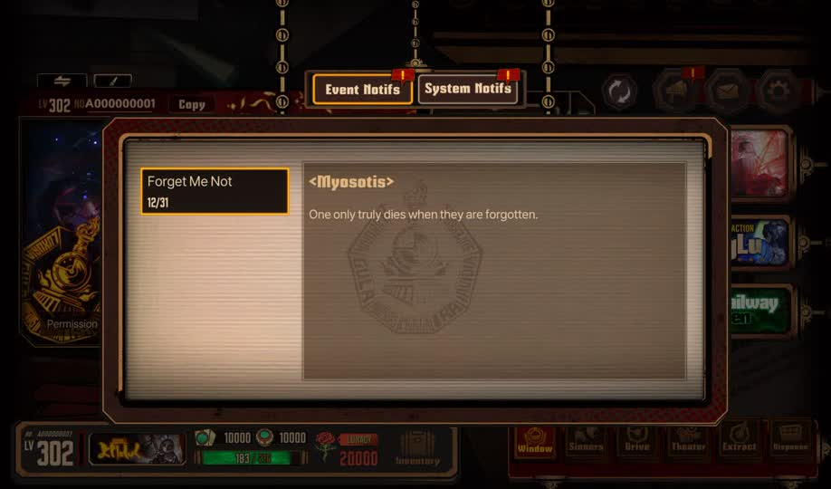
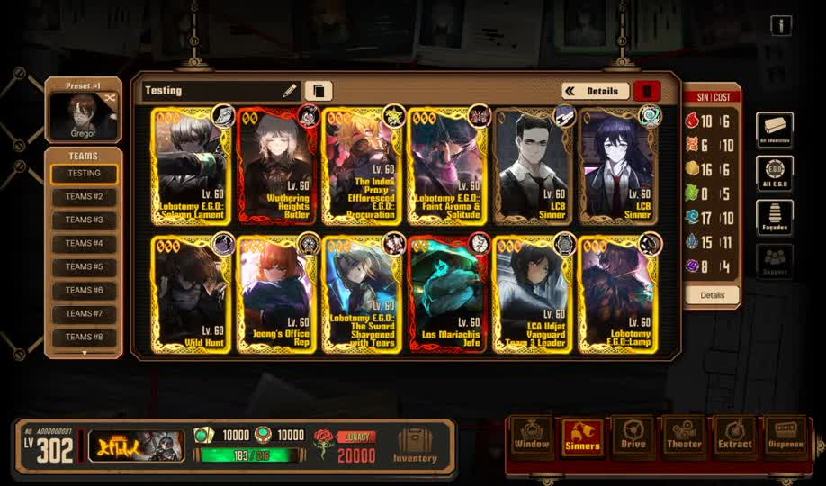
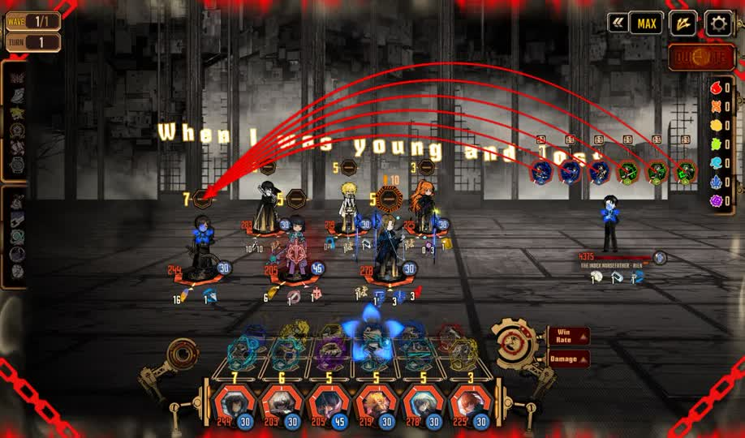
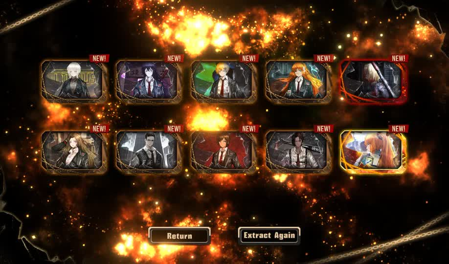

# myosotis-server

Play Limbus Company on your own computer, with your own save. Based on FurinaLC. For a bigger
project, see [OpenLethe](https://github.com/LEAGUE-OF-NINE/OpenLethe/)
([Discord](https://discord.com/invite/XjsaUNwU)).

## Install

1. Install Limbus through Steam and start it once.
2. Download the package for your system from
   [Releases](https://github.com/paladiga484/myosotis-server/releases/latest):
   - **Windows:** run the `Setup.exe`, then open **Limbus Private Server** and press **Play**.
   - **Linux:** run `bash LimbusPrivateServer-Linux-<version>.run`, then type `limbus`.

Each package works with one Limbus version. Your Steam game files are never changed.
[INSTALL.md](INSTALL.md) has copy-paste commands.

Skins and new characters come built in ([limbus-skins](https://github.com/paladiga484/limbus-skins)).

Screenshots

| | |
|---|---|
|  |  |
|  |  |
|  |  |

## What works

- **Works:** your save, every identity at any level, gacha, teams, cosmetics, stories, Mirror
  Dungeon, the mod menu.
- **Plays, no rewards yet:** story stages, EXP Luxcavation, Refraction Railway.
- **Not yet:** Boss Raids, Mirror Dungeon shops and crafting, event rewards.

## Playing with friends

Each person keeps their own save. Connect with [Tailscale](https://tailscale.com) (never open
a port on your router), then use the app's "A friend's server" card, or on Linux:
`./play.sh friend <their Tailscale address> <token>`.

In-game coupon commands

| Type this | It does |
| :--- | :--- |
| `RESET` | start your save over |
| `SYNC` | add new game items |
| `P10101L50G4` | identity 10101 to level 50, uptie 4 |
| `E20101G4` | E.G.O. 20101 to uptie 4 |
| `I11C100` | 100 of item 11 |
| `U1L100S100` | your level and stamina |

## Build it yourself

Install the .NET 11 SDK, then run `dotnet run --project Server -c Release`.

MIT license.
