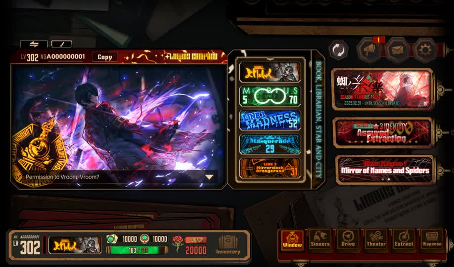
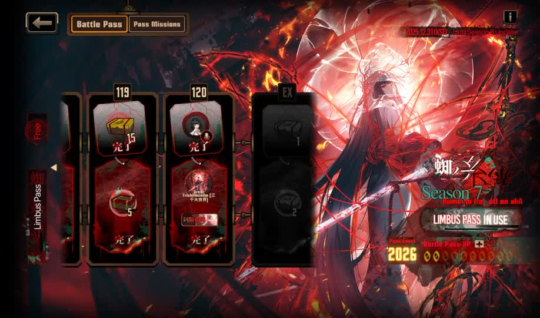
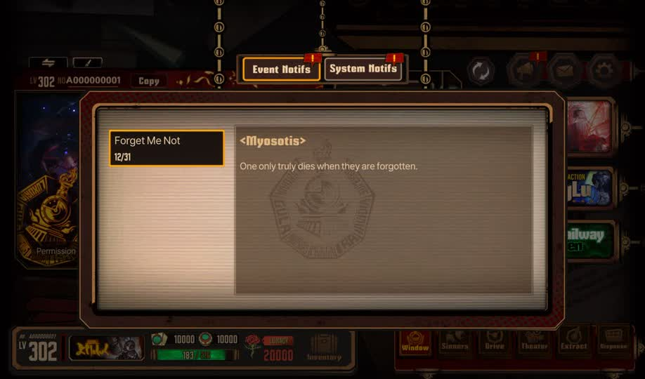
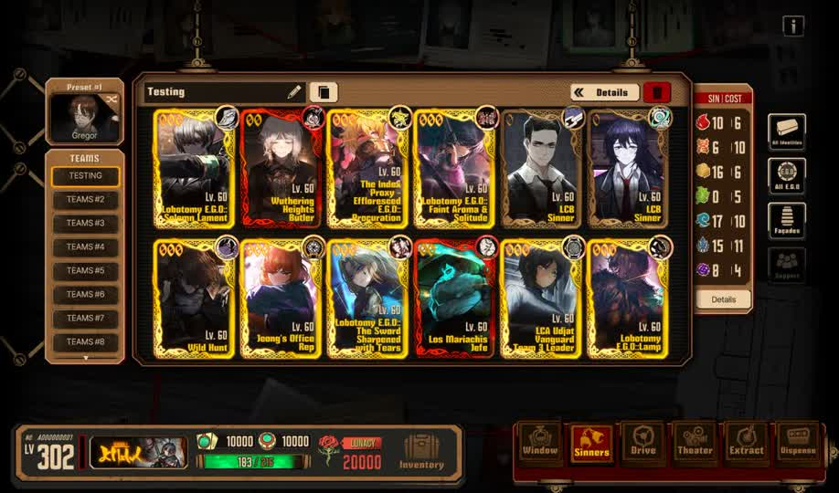
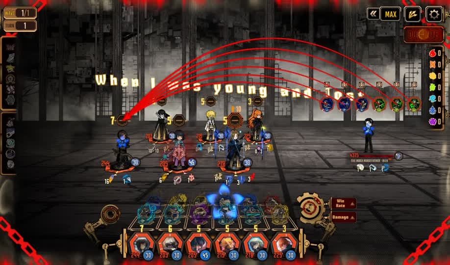
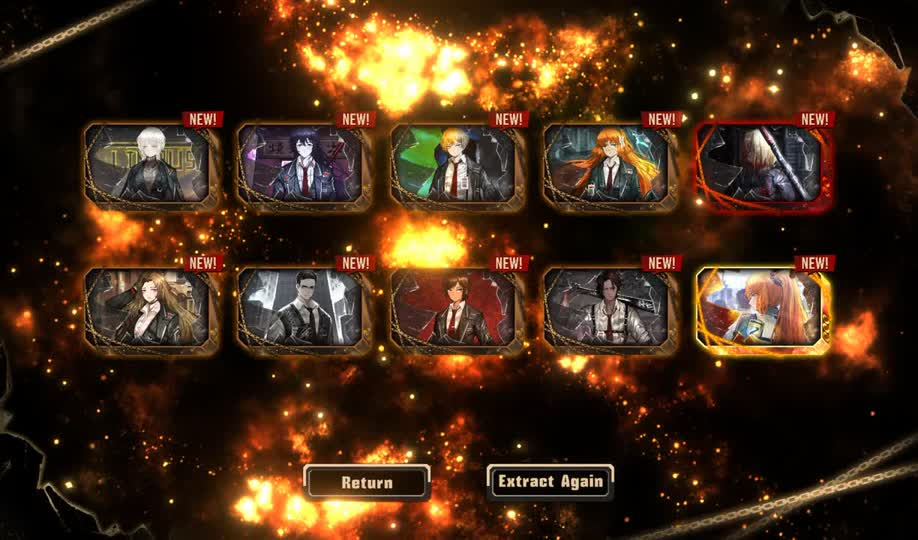

# myosotis-server🌙🔑 (READ FEATURES)

Limbus Company private server, originally FurinaLC.

For a better and more complete private server, you can use https://github.com/LEAGUE-OF-NINE/OpenLethe/

Don't forget to join the lethe discord: https://discord.com/invite/XjsaUNwU

## Quick start: the ready-made packages

No .NET, no building. Download the package for your system from
[Releases](https://github.com/paladiga484/myosotis-server/releases/latest). Each one is made for
one Limbus version (it's in the name). Nothing of the game ships in it: on the first start the
server reads the game's data from your own Limbus install, and your Steam copy is never modified.

Before either: install Limbus through Steam and start it once, up to the title screen.

**Windows**

1. Unzip `LimbusPrivateServer-Windows-<version>.zip` somewhere normal (Desktop, Documents).
2. Double-click **Limbus Private Server**. If Windows says "Windows protected your PC", click
   More info, then Run anyway (the app isn't signed).
3. Press **Play**. The window shows each step and says when you're on your own server.
4. **Mod menu** at the bottom edits your save: identities, E.G.O., items, cosmetics.

**Linux** (Steam with Proton)

```sh
tar xzf LimbusPrivateServer-Linux-<version>.tar.gz
cd LimbusPrivateServer
./play.sh check     # finds Steam, Limbus, its Proton prefix and Proton; changes nothing
./play.sh           # starts the server, Limbus, then attaches the patch
./play.sh menu      # the mod menu, while it runs
```

Leave the terminal open while you play; closing Limbus stops the server.

**A friend's server**: install Tailscale on both computers. On Windows, fill in the card "A
friend's server" in the app; on Linux, `./play.sh friend 100.x.y.z your-secret-token`, then
`./play.sh join`. Never open a port on your router. Each package's README.txt covers hosting,
what works and what to do when something breaks.

**Skins** (optional): [limbus-skins](https://github.com/paladiga484/limbus-skins) dresses
identities as the bosses and characters they mirror. With it installed:
`limbus-skins run --yes -- ./play.sh` (Linux) or
`limbus-skins run --yes -- "<folder>\Limbus Private Server.exe"` (Windows).

Check a download against the `.sha256` file beside it: `sha256sum -c <file>.sha256`.

## General Showcase

<details>
<summary>Screenshots</summary>

-- --

| | |
|---|---|
|  |  |
|  |  |
|  |  |
| | |

</details>

-- --

<details>
<summary>Features</summary>

-- --

- automatically creates account on login and is maxed out account (battlepass, ids, egos, etc.)

- supports multiple accounts i suppose? no friends doe

- full profile modification! u can modify ur card/banner showcase and whatnot, including support

- teambuilding & announcer stuff

- all stories unlocked so u can just play any node and theater

- story node battles, luxcavation battles

- mirror dungeon: normal, hard, infinite and extreme (MDE), whatever season the game's data has
  (season 8 on 1.117) - maps, theme floors, starting gifts, every floor to its boss, resume

- basic dummy gacha implementation

- commands through the coupon menu in-game (case doesn't matter, the client uppercases em):

    | Command | Arguments | Description | Example |
    | :--- | :--- | :--- | :--- |
    | `RESET` | - | wipe & reseed ur data | `RESET` |
    | `SYNC` | `ITEM`, `EGO`, `ANNOUNCER`, `PERSONALITY`, `TICKET`, `BANNER` | sync missing static data (no args = all) | `SYNCITEMEGO` |
    | `P` | `<id>L<level>G<gacksung>` | set personality level & uptie | `P10101L50G4` |
    | `E` | `<id>G<gacksung>` | set ego uptie | `E20101G4` |
    | `I` | `<id>C<count>` | set item count | `I11C100` |
    | `U` | `<uid>L<level>S<stamina>` | set your own user level & stamina (`<uid>` must be yours) | `U1L100S100` |

</details>

-- --

<details>
<summary>Known Limitations</summary>

-- --

- gacha is kinda broken if the banner doesnt have anything in staticdata

- story dungeon, boss raid and refraction are not supported!! story stages, exp luxcavation and
  railway play but give no rewards, event rewards grant nothing, and mirror dungeon shops and
  gift crafting are empty stubs (its gift and exit rewards work)

- etc.


</details>

## Hosting for friends

<details>
<summary>Let friends play on your server</summary>

-- --

Everyone gets their own save either way - Limbus has no multiplayer. Hosting only means your
friends don't run a server themselves.

- **Never port-forward 3000.** Put everyone on a private network instead: Tailscale (or plain
  WireGuard). Add your machine's address on it to `host`, keeping `127.0.0.1` for yourself:
  `"host": "127.0.0.1, 100.64.0.7"`. The server refuses every-interface binds (`0.0.0.0`, `::`)
  and refuses non-local addresses unless `auth.requireToken` is true.
- Auth codes are signed with a key made on first start (`myosotis.key`, beside `Config.json`).
  Keep it private: whoever has it can sign in as anyone. Delete it to sign everyone out.
- The mod menu (`/tweak`) only answers requests from the machine the server runs on.
- Each friend's `myosotis.ini` points `server=` and `serverinfos_url=` at your private-network
  address, with a `token=` of their own: the token *is* their account, like a password.
- On Windows, `App/` is a small app ("Limbus Private Server.exe") that does all of this from a
  window: it starts the server out of sight and opens `/launcher` (on when `launcher.enabled`
  is set) - play here or on a friend's server, host, open the mod menu, quit.

</details>

## Setup (Windows)

<details>
<summary>Prerequisites</summary>

-- --

- **.NET 11 SDK**: https://dotnet.microsoft.com/en-us/download/dotnet/thank-you/sdk-11.0.100-preview.7-windows-x64-installer

</details>

-- --

<details>
<summary>Running</summary>

-- --

### Everything below assumes PowerShell

1. clone the repo: `git clone https://github.com/yuvlian/myosotis-server; cd myosotis-server`

2. modify `Config.json` as needed

3. start server: `dotnet run --project Server -c Release`

Notes:

- When the game updates, you probably need to update the `versions` in `Config.json`.

- To get the new stuff (IDs, EGOs, etc.) automatically, you have to update the `LimbusStaticData` and then run the `sync` coupon command.

- As of right now, I haven't made any tool to dump the static data because I'm lazy nor do I want to keep dumping & updating them. You can try using commands to add stuff with the IDs manually, or join the lethe discord to find out how to dump static data yourself.

</details>

-- --

<details>
<summary>Playing</summary>

-- --

1. download https://github.com/yuvlian/myosotis/releases/download/0.1.2/win-x64.7z and extract

3. run `myoink.exe`

4. start limbus company!

</details>

## Project Meta

<details>
<summary>Structure</summary>

-- --

```
myosotis-server/
├── Common/               # shared config, seed values, time/utils
├── Config.json           # server config: host/port, db, static data, blabla.
├── Database/             # ef core + sqlite, 3nf
│   ├── Entities/         # table entities
│   ├── Migrations/       # migrations, duh
│   └── Repositories/     # per-domain data access
├── Resource/             # static data loader
├── Server/               # asp.net core
│   ├── Api/              # /api/* endpoints
│   ├── Iap/              # /iap/* endpoints
│   ├── Login/            # /login/* endpoints
│   ├── Log/              # /log/* endpoints
│   └── Middleware/       # auth + body logging
└── Types/                # game packet types
```

</details>

-- --

<details>
<summary>License</summary>

-- --

MIT

</details>
